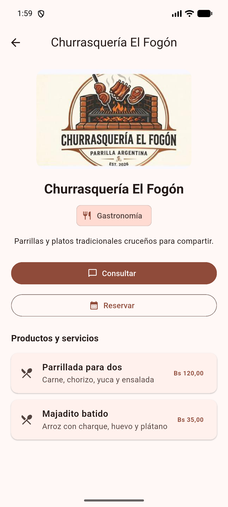

# ConectaCruz · Churrasquería El Fogón

Aplicación móvil que conecta a **Churrasquería El Fogón** —un negocio de
barrio de Santa Cruz de la Sierra— con sus clientes: la carta con precios, las
consultas y las reservas en un solo lugar.

> Proyecto de la **Actividad 01** — *¿Qué framework móvil le conviene a un
> negocio local de Santa Cruz?* · Aplicaciones Móviles I (SIS-0180) · UPDS
>
> Integrantes: **Luis Gerardo Portillo Gonzales · Marco Antonio Kiataque Uchima ·
> Anderson Carvajal Romero**


---

## El problema

La carta, las consultas y las reservas viven en tres lugares distintos. Los
precios se mandan por foto de WhatsApp, cada consulta es un chat suelto y las
reservas se anotan en un cuaderno del mostrador. El resultado: un cliente que
pregunta la parrillada y no recibe respuesta a tiempo se va a otro lado, y dos
grupos terminan con la misma mesa el mismo viernes.

La solución planteada es una sola aplicación que reúne el catálogo con
precios, las consultas y las reservas, y deja todo registrado.

## Tres alternativas evaluadas

| Opción | Tecnología | Alcance |
|---|---|---|
| **Flutter** | Dart | Un solo código para Android e iOS |
| **React Native** | JavaScript y React | Un solo código |
| **Nativo** | Kotlin + Swift | Dos aplicaciones separadas |

Se descartaron las soluciones WebView (Ionic) porque empaquetan una página
web y penalizan justo lo que más importa: el desplazamiento fluido de una
carta con fotos.

## Criterios ponderados

| Criterio | Peso | Por qué |
|---|---|---|
| **Costo** | 25% | El negocio no puede pagar dos equipos de desarrollo |
| **Curva de aprendizaje** | 25% | Equipo de tres estudiantes sin experiencia móvil previa |
| **Rendimiento** | 20% | Carta larga con fotos en celulares modestos de gama baja |
| **Comunidad** | 15% | Sin soporte pago: dependemos de documentación y respuestas públicas |
| **Soporte Android e iOS** | 15% | El negocio quiere estar en las dos tiendas |

La suma de los pesos es exactamente 100. A la curva de aprendizaje se le dio
el mismo peso que al costo **aunque eso perjudica a la opción que terminó
ganando** — si se le bajara el peso para favorecer un resultado, la matriz no
serviría para defender nada.

## Resultado

| Opción | Puntaje ponderado (sobre 500) | Sobre 5 |
|---|---|---|
| **Flutter** | **435** | **4,35** |
| React Native | 430 | 4,30 |
| Nativo | 280 | 2,80 |

**Elección: Flutter, con 435 puntos sobre 500.** La diferencia con React
Native es de cinco puntos (un uno por ciento), así que la recomendación se
sostiene en argumentos del caso —costo y rendimiento pesan 45 de 100— y no en
una superioridad técnica evidente.

### Por qué Flutter

- **Un código para Android e iOS** y un solo equipo, con presupuesto limitado.
- **Dibuja su propia interfaz** en lugar de pedirle los controles al sistema
  operativo, lo que según su documentación oficial evita un cuello de botella
  importante de rendimiento.
- **Dart se compila a instrucciones ARM**: lo que se instala no es código
  interpretado.
- Documentación oficial gratuita y bien organizada; **hot reload** que acorta
  el ciclo de prueba.
- La revisión de Joët y Taneski (2025) encontró mayor satisfacción a largo
  plazo que React Native (mediana 68,1 vs 57,2; p = 0,004).

### Lo que lo debilita

- **El margen es de un uno por ciento**: no alcanza para decir que Flutter sea
  mejor que React Native en abstracto, solo que encaja un poco mejor en este caso.
- **Hay que aprender Dart**: el equipo no lo conocía; con React Native se
  arrancaría sabiendo el lenguaje.
- **No probamos en celulares reales**: nuestras afirmaciones de rendimiento
  vienen de documentación y estudios de terceros, no de mediciones propias.
- Joët y Taneski (2025) no encontraron diferencias significativas en
  popularidad (p = 0,59) ni en interés (p = 0,818), y React Native publica
  **más ofertas de trabajo**.

## Estado actual



- ✅ **Entorno verificado** — Flutter 3.47.9, Android SDK 36.0.0 y emulador
  **Pixel_6** en Windows 11; `flutter doctor` y `flutter analyze` sin problemas;
  tests 15/15 pasando (30 verificaciones).
- ✅ **Interfaz funcional** — pantalla de bienvenida con logo, marca del
  negocio y botón «Ver negocio», construida con `Scaffold` y Material 3.
- ✅ **Catálogo** — el negocio muestra sus platos desde la base de datos.
- ✅ **Backend real** — Supabase (PostgreSQL): consultas y reservas quedan
  registradas; seguridad por fila (RLS) activa.
- ✅ **iOS** — el proyecto está ya configurado para iOS; compilar exige Xcode,
  que solo corre en macOS. Pendiente por falta de una Mac.

## Próximos pasos

1. Probar en **celulares reales** de gama baja y medir memoria, CPU y tiempos
   de carga — el límite que reconocimos en la discusión.
2. Reemplazar los datos de ejemplo por más contenido real del negocio.
3. **Versión para iOS**: el código ya sirve; falta una Mac con Xcode o un
   servicio de compilación en la nube.

## Cómo ejecutar

```bash
flutter pub get
flutter doctor
flutter run        # o presionar Run ▶ en Android Studio
```

Dispositivo destino recomendado: **Emulador Pixel_6** (Android Studio →
Tools → Device Manager). iOS requiere una Mac.

## Alcance del documento y fuentes

Este README resume la defensa del proyecto; la metodología completa —el
análisis ponderado, la discusión de limitaciones y las fuentes APA 7— está en
el **Informe IMRyD** (`Informe_IMRyD_Frameworks_ConectaCruz.docx`, en la
carpeta del proyecto de la actividad) y la presentación en **ConectaCruz ·
Churrasquería El Fogón.pptx**.

Referencias:

- Crespo Parrales, W. A. (2026). *Comparación de Flutter y React Native en el
  desarrollo de aplicaciones móviles multiplataforma para las Pymes* [Tesis de
  posgrado]. Universidad Politécnica Salesiana.
- Flutter. (s. f.). *Flutter architectural overview*.
  https://docs.flutter.dev/resources/architectural-overview
- Joët, G., y Taneski, V. (2025). State-of-the-art cross-platform mobile
  application development frameworks. *Informatics, 12*(2), 45.
  https://doi.org/10.3390/informatics12020045
- Meta Platforms. (s. f.). *About the New Architecture*. React Native.
  https://reactnative.dev/architecture/landing-page

---

**Actividad 01 · Criterio de verificación N.° 4 — Aplicaciones Móviles I (SIS-0180)**
UPDS · Santa Cruz de la Sierra · 2026
